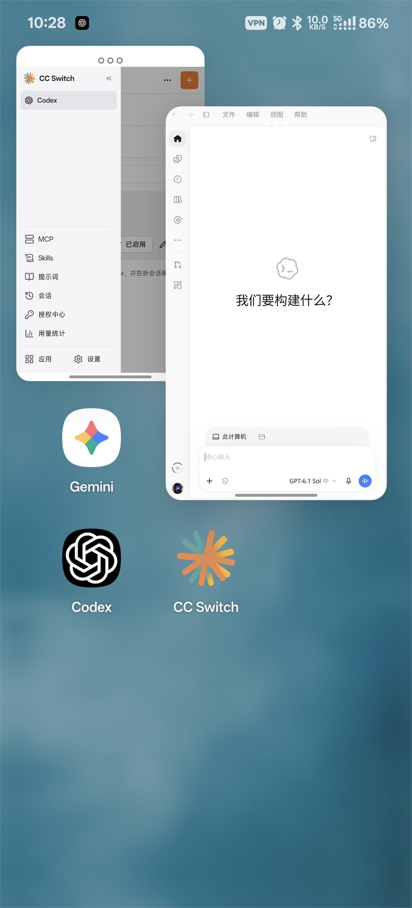
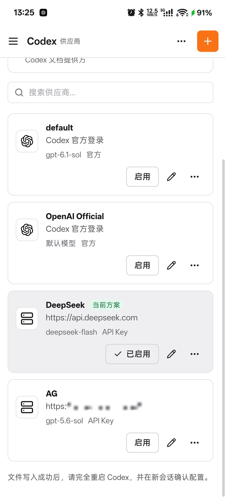
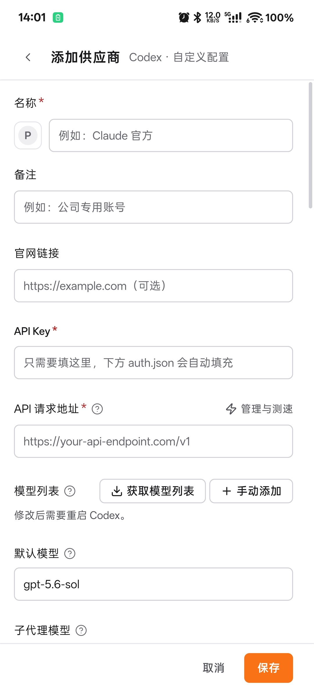
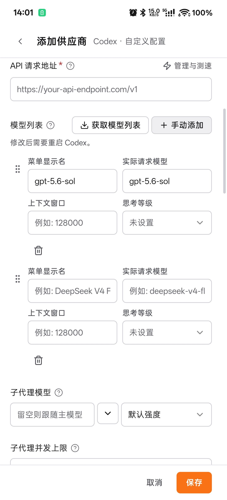
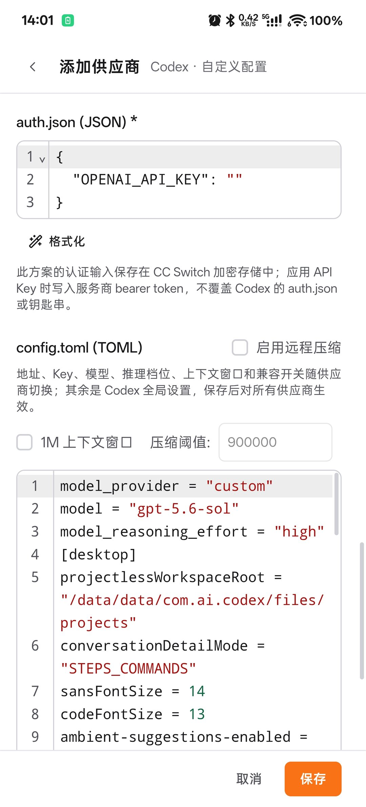
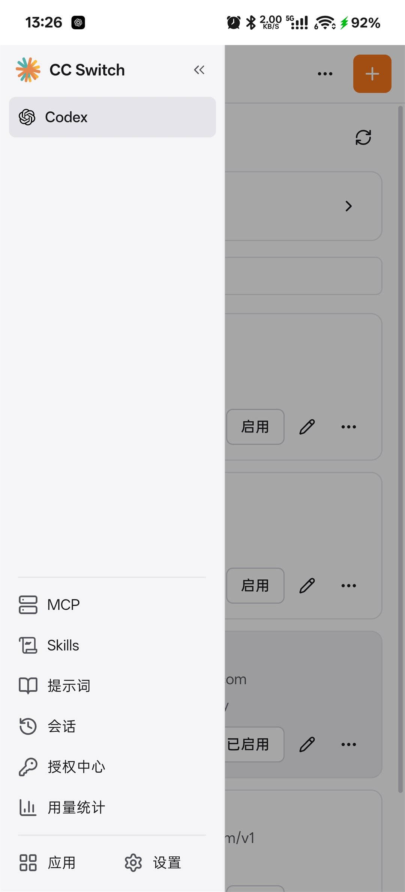
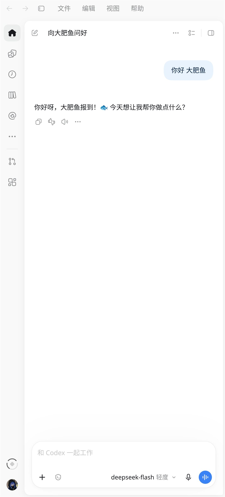
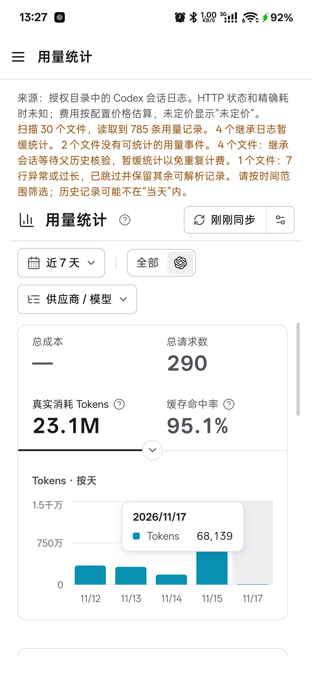
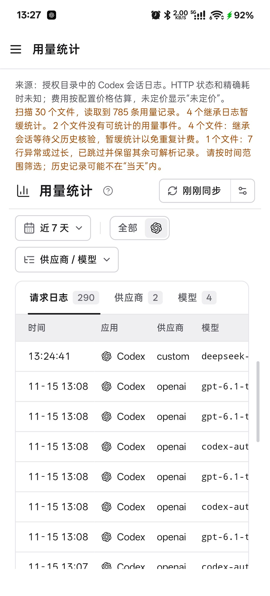

# CC Switch Android

<table>
  <tr>
    <td width="33%"></td>
    <td width="33%"></td>
    <td width="33%"></td>
  </tr>
  <tr>
    <td></td>
    <td></td>
    <td></td>
  </tr>
  <tr>
    <td></td>
    <td></td>
    <td></td>
  </tr>
</table>

[**codex-desktop-android**](https://github.com/JinShichang/codex-desktop-android) 的**专属配套工具**，用于在手机上管理、切换 Codex 服务商与配置。

基于 CC Switch 移植，保留原版界面与操作逻辑，适配手机横竖屏。独立 Android APK，支持 Android 11 及以上的 ARM64 设备；提供供应商、模型、MCP、Skills、提示词、会话及用量统计管理。

## 使用

1. 从 [Releases](../../releases) 下载 APK，并安装支持目录授权的 Codex Android 版本。
2. 点击「连接」，在系统文件选择器侧栏选择 Codex，授权整个 `.codex` 目录。
3. 添加供应商并点击「启用」，写入完成后重启 Codex 生效。切换前无需关闭 Codex。

启用「历史推理与ID过滤（解决不同源错误）」时，需要保持 CC Switch 在后台运行，并按提示解除后台限制。

构建方法见 [构建说明](docs/build.md)，对接要求见 [Codex 目录授权说明](docs/codex-provider-contract.md)。

## 致谢与许可

基于 [CC Switch](https://github.com/farion1231/cc-switch) 开发，遵循 [MIT 许可证](LICENSE)。上游版权及第三方许可见 [THIRD_PARTY_NOTICES.txt](THIRD_PARTY_NOTICES.txt)。
